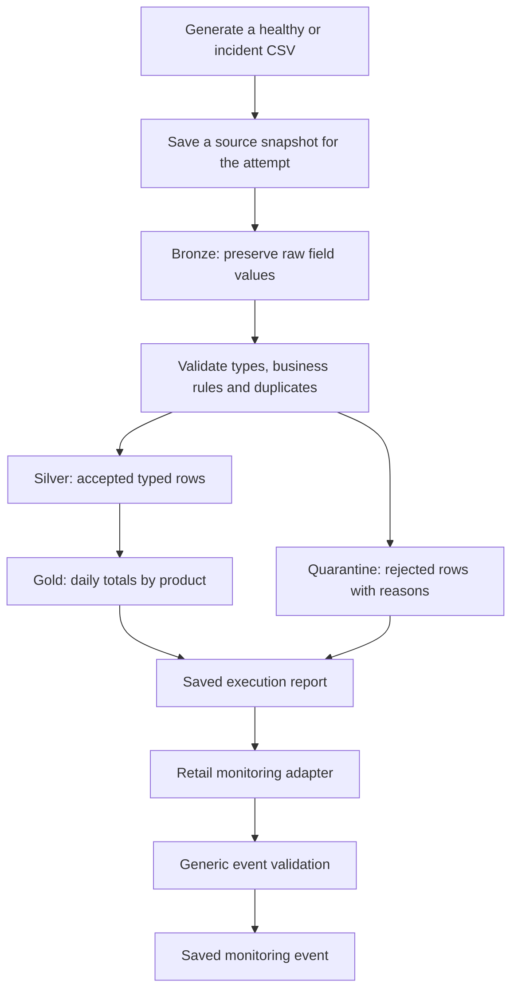
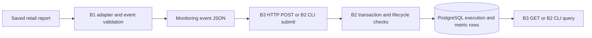

# PipelineIQ progress

Current milestone: B1–B3 implemented; PostgreSQL persistence and the local monitoring API are verified.
Milestone A1–A6 remains complete.
Next proposed batch: B4 — Airflow orchestration, retries and failure reporting.

Last learning-notes update: 2026-11-23. Read the learning checkpoint below to
understand the system, then use the verification sections to see what actually ran.
Commands in this document assume you are in the repository root. Generated files
exist on the development machine but are not on GitHub; on a fresh clone, follow
the [README setup and source-generation instructions](../README.md) first.

Authorization and Git:

- On 2026-11-23 the developer explicitly authorized completing B2 and B3 together, with documentation updates and the established commit/push workflow.

- On 2026-11-20 the developer requested finishing Milestone A and making the necessary commits.
- On 2026-11-21 the developer authorized continuing Milestone B with documentation and GitHub commits.
  This batch implements B1, following the established small-batch workflow.
- Repository: https://github.com/janjua321/pipelineIq; main tracks origin/main.
- e0f53dc: source generation and Bronze baseline.
- 7f7c813: Silver validation and quarantine.
- 6518508: Gold aggregation and persisted end-to-end run metrics (A5), pushed.
- 4a5c5d2: A6 replay and recovery, pushed.
- [e97ca7b](https://github.com/janjua321/pipelineIq/commit/e97ca7b): B1 monitoring contract,
  retail adapter, tests and documentation, pushed.
- 32565ff: B2 PostgreSQL storage, migrations, tests and learning documentation, pushed.
- B3 is the current checkpoint; its commit contains this progress update.
- Keep committing/pushing each authorized completed batch with updated progress and tests.
- PIPELINEIQ_AGENT_BRIEF.md is local, ignored, and never tracked. Generated data,
  environments, runtimes, and caches remain ignored.

Completed:

- A1: pinned local Python/Spark/Delta environment and real persistence smoke test.
- A2: seeded source generator with exact defect counts and deterministic file output.
- A3: explicit raw-text schema, Bronze preservation, ingestion metadata and inspection.
- A4: typed Silver, deterministic duplicate selection, original-value quarantine with reasons.
- A5: UTC daily/product Gold aggregates (transactions, units, decimal revenue), full
  pipeline command, and persisted JSON run metrics including failures.
- A6: exclusive local batch lock, immutable source snapshots, isolated attempt directories,
  atomic completion manifests, identical-input reuse, source/policy conflicts,
  saved-output integrity checks, and retries after partial writes.
- B1: contract 1 monitoring snapshots, strict generic validation, a retail report adapter,
  deterministic atomic file export, source/replay evidence, CLI, tests and contract documentation.
- B2: PostgreSQL execution/metric tables, checksum migrations, transactional writes, lifecycle conflicts, local setup and queries.
- B3: FastAPI submission, exact lookup, filtered pagination, readiness, strict input validation and OpenAPI docs.

**Learning checkpoint: understand what we have built**

Milestone A processes transaction data. Milestone B1 describes those executions in
a format that a monitoring system can understand. The saved run report connects
the two: Spark measures the results, and the adapter translates those measurements.



The diagram shows the successful data path. Failures also produce execution
reports when they happen inside the runner. A6 separately publishes a completion
manifest only after all stages succeed; that manifest identifies the published
tables. A monitoring event alone does not prove publication or table integrity.

**Why B1 was needed**

The retail report has fields such as `null_customer_id_count`. A document-indexing
pipeline might instead report `unreadable_documents`. Future monitoring code should
be able to store and compare named measurements from either producer. B1 provides
the shared structure, while each producer's adapter owns its business meanings.

| Concept | Meaning in this project | Why it matters |
| --- | --- | --- |
| Contract/schema | Agreed event fields, types and meanings, identified by `contract_version` | Consumers can reject a report they cannot interpret |
| Adapter | Code that maps a retail report into the shared event format | Retail rules stay outside the generic monitor |
| Denominator | The population used to calculate a rate; retail uses input rows | A count of 11 means different things out of 80 and out of 8,000 |
| Null | A measurement is unknown, or a rate is undefined | Failure before validation must not look like zero defects |
| Evidence reference | A saved path to a report, source or output table | A reader can trace a measurement back to its source |
| Execution snapshot | The currently exported state of one execution | Running and terminal states can occupy the same event path |
| Atomic replacement | Write a complete temporary JSON file, then replace the destination | Readers see a complete old or new document |
| Idempotent export | Exporting the same unchanged report again leaves the event file unchanged | Repeated delivery does not create extra event files |

**Trace the measured incident example**

The saved incident report contains 80 input rows, 56 valid rows and 24 quarantined
rows. The retail adapter checks `80 = 56 + 24`. It also checks that the saved rates
agree with their counts. It does not read the source CSV or rerun Spark validation.

There are 11 rows with a missing customer ID. The adapter represents this as the
following excerpt from `quality_metrics`:

```json
{
  "null_customer_id_count": {
    "count": 11,
    "denominator": 80,
    "rate": 0.1375
  }
}
```

The rate is `11 / 80 = 0.1375`, or 13.75%. This is a proportion; it does not by
itself mean an anomaly has been detected. Historical comparison and alerting are
later work. A row can have several defects, so quality-category counts must not be
added to calculate distinct quarantined rows. The 7 duplicates are already included
in the 24 quarantined rows.

Revenue stays the string `"7686.31"` in event properties to preserve the pipeline's
exact decimal result. Exporting the event does not generate additional revenue.

**Distinguish a batch, a run and an export**

| Identifier/action | Example or behavior |
| --- | --- |
| `pipeline_id` | `retail_transactions` identifies the producer |
| `batch_id` | `a2-incident-001` identifies a logical input batch within the runner's output root |
| Top-level `run_id` | A new UUID for each invocation of the full pipeline runner |
| Exporting a report | Preserves that report's run UUID; exporting does not create an execution |
| Repeating a completed batch | Creates a new execution report with `status: reused` and an original-run reference |

Bronze ingestion and Silver validation also have their own stage IDs. B1 uses the
top-level execution UUID from `data/pipeline/metrics/`, not a stage ID from a table.

Two exports of one report leave one event file. Two pipeline invocations produce
two reports and can produce two event files. If the second invocation reused the
first one's outputs, its rows and revenue must not be counted again as newly
processed data. Its duration measures verification rather than fresh processing.

**Entry points and a useful code-reading order**

| Read this file/function | Responsibility |
| --- | --- |
| [scripts/run.sh](../scripts/run.sh) | Selects the Python/Java environment and starts `python -m pipelines.run` |
| [pipelines/run.py](../pipelines/run.py): `main`, `run_pipeline`, `execute_attempt` | Creates Spark, manages execution/reuse, runs stages and saves metrics |
| [pipelines/monitoring.py](../pipelines/monitoring.py): `main`, `export_report` | Reads one saved report and writes its event; this is the B1 CLI entry point |
| Same file: `adapt_report` | Maps fields and enforces retail-specific relationships |
| [monitoring/events.py](../monitoring/events.py): `quality_metric`, `validate_event`, `dumps_event` | Builds measurements, validates the generic contract and serializes deterministic JSON |
| [Adapter tests](../tests/unit/test_monitoring_adapter.py) and [event tests](../tests/unit/test_monitoring_events.py) | Show accepted examples, rejected inputs and expected replay behavior |

`python -m pipelines.monitoring` runs the module's `main()` function. Its call path
is `main → export_report → adapt_report → validate_event`, followed by serialization
and file publication. This command uses Python only. The separate `scripts/run.sh`
command starts Spark, including when the runner subsequently reuses a batch.

The generic validator checks structural and measurement rules, such as UUIDs,
timezone-aware timestamps and rate arithmetic. The retail adapter checks business
relationships, including `input = valid + quarantined`. That distinction lets
another pipeline legitimately turn four documents into eight output records.

**Where to find each result**

| Location | What to read there |
| --- | --- |
| `data/source/<batch-id>.csv` | Generated healthy or incident input |
| `data/pipeline/attempts/<run-id>/` | Snapshot and table files produced during an attempt; may include unpublished failures |
| `data/pipeline/batches/<batch-id>.json` | Completion manifest and authoritative published output paths |
| `data/pipeline/metrics/<run-id>.json` | Original retail execution report, including failed or reused executions |
| `data/monitoring/events/retail_transactions/<run-id>.json` | B1's translated monitoring snapshot |

For complete field definitions and validation rules, read the
[monitoring event contract](monitoring-events.md). For generating fixtures and
inspecting individual Delta layers, use the [README](../README.md).

Run and inspect:

```bash
bash scripts/run.sh --source data/source/a2-healthy-001.csv --batch-id a2-healthy-001 --show-gold
bash scripts/run.sh --source data/source/a2-incident-001.csv --batch-id a2-incident-001 --show-gold
for report in data/pipeline/metrics/*.json; do
  .venv/bin/python -m pipelines.monitoring --report "$report"
done
bash scripts/test.sh
```

- Both demonstration batches are published. Repeating these commands verifies and reuses outputs.
- Completion manifests: data/pipeline/batches/<batch-id>.json.
- Per-execution metrics: data/pipeline/metrics/<run-id>.json.
- Actual table paths are recorded in the manifests under outputs; each successful
  attempt includes Bronze, Silver, quarantine and Gold Delta tables.
- Read tables through these published paths, never by unioning all attempt directories.
- Use --root to create a separate intentional replay environment.
- Earlier standalone bronze.sh/silver.sh commands remain supported and reject existing paths.

Verified B1 results (2026-11-21):

- Focused monitoring/adapter unit suite: 65 passed in 0.11s.
- Full suite including Spark/Delta integration: 119 passed in 69.52s (exit 0).
  Local log: .cache/milestone-b1-tests.log (ignored).
- Integration assertions adapt real empty/all-invalid reports, a missing-source failure,
  a partial-write failure and a reused run. Unit tests also prove another pipeline can
  expand input rows and define different quality names without retail logic in the monitor.
- CLI tests run with site-packages disabled, proving export has no Spark dependency.
- The three saved A6 reports exported with statuses completed, completed_with_warnings,
  and reused. Repeated exports produced identical JSON and unchanged modification times.
- Exactly three event files were created under data/monitoring/events/retail_transactions/.
  Source-report hashes stayed unchanged. Incident metrics remain 80 input, 56 valid,
  24 quarantined; missing-customer and invalid-amount rates remain 11/80 = 0.1375.
- Reused event references d8f3d7b1-499f-47cb-aa73-300f98dd8386, preserving the distinction
  between an execution and newly processed data.
- Offline uv build produced a source distribution and wheel using the pinned build backend.
  Wheel inspection confirmed monitoring/events.py and pipelines/monitoring.py are included;
  generated data, caches and the local agent brief are excluded. No dependencies added.
- See docs/monitoring-events.md for fields, lifecycle, denominators and adapter mapping.

Previous Milestone A verification (2026-11-20):

- A5 targeted integration suite: 4 passed in 33.11s.
- Full Milestone A suite: 54 passed in 69.08s (exit 0).
- Tests cover exact decimal/day/product aggregation, empty/all-invalid inputs, error
  metric persistence, partial Silver/quarantine write failure, clean retry, no-op reuse,
  changed-source rejection, altered-output detection, lock exclusion, and atomic JSON writes.
- CLI help and the optional --show-gold flow executed successfully.
- Healthy and incident commands completed, then incident replay returned reused.
- Verified exactly two attempt directories and three execution reports; replay points
  to the original incident output paths and creates no new attempt.

| Batch | Input | Valid | Quarantine | Duplicates | Revenue |
| --- | ---: | ---: | ---: | ---: | ---: |
| a2-healthy-001 | 100 | 100 | 0 | 0 | 14712.35 |
| a2-incident-001 | 80 | 56 | 24 | 7 | 7686.31 |

- Incident missing-customer count: 11; invalid-amount row count: 11.
- Incident rates: quarantine 0.30, duplicates 0.0875, missing customers 0.1375,
  invalid amounts 0.1375. Each denominator is 80 input rows.
- Previous checkpoints: A3 38 tests passed; A4 47 tests passed.

Contracts and decisions:

- Monitoring contract_version "1" is independent from producer schema_version and policy_version.
  Execution identity is (pipeline_id, run_id); all event fields are explicit, with null for unknowns.
- Core validates generic types, aware timestamps, statuses and count/denominator/rate agreement.
  The retail adapter alone enforces row conservation, quality counts within quarantine,
  completion status, saved rates and required success evidence.
- Export is a current snapshot at data/monitoring/events/<pipeline-id>/<run-id>.json.
  Identical re-export is a no-op; changed snapshots replace that file atomically.
  Reused executions retain their original run reference and must be excluded from newly
  processed totals and processing-time baselines.

- Pipeline dependencies unchanged: Python 3.12.16, Java 21.0.13, PySpark 4.0.5, Delta 4.0.1,
  pytest 9.2.0. Local Spark uses two worker threads and UTC.
- Every input row enters Silver or quarantine. Duplicate occurrences are quarantined;
  valid + quarantined = input. Overlapping reasons are not summed as distinct bad rows.
- Missing customer counts include blank/whitespace IDs. Invalid amounts count the union
  of invalid quantity and invalid price. Empty-batch rates are null; unknown failure counts
  are null. Revenue is exact decimal text in JSON.
- Metrics include run/pipeline/batch IDs, source path/hash, start/finish times, elapsed
  duration, schema/policy versions, status, counts, rates, outputs and error summary.
- Reuse gets a new execution UUID and duration, but references the published data counts
  and outputs. Consumers must not treat reused reports as additional processed revenue.
- Bump POLICY_VERSION for changes affecting data semantics. A completed batch with new
  source bytes or a different policy requires a new batch ID or output root.

Known limits:

- Local Linux/Unix filesystem workflow, one active writer per batch. No distributed
  locking or power-loss/network-filesystem durability guarantee.
- Individual Delta writes are separate transactions. The runner publishes a manifest only
  after every stage succeeds; partial failed attempts are retained and excluded from publication.
- A hard kill can leave a running metric report; the completion manifest is authoritative.
  A retry starts a fresh attempt when no manifest exists. No automatic artifact cleanup yet.
- JVM startup precedes the run lifecycle and its duration measurement. A JVM startup failure
  does not create a pipeline report. Ordinary in-run exceptions do create failed reports.
- Deduplication is within a batch. Generator data uses one fixed UTC day. PostgreSQL
  collection and the local API are implemented; orchestration, ML, RAG and the dashboard are future work.
- B1 exporter is manual single-writer tooling, with no ordering of stale/concurrent updates
  and no historical snapshot archive. B2 applies stricter lifecycle/conflict rules when persisting to PostgreSQL.
- Evidence paths are references, not proof of publication or output integrity. A6 completion
  manifests remain authoritative. Monitoring export does not re-read Delta or verify artifacts.
- B1–B3 are verified; developer hands-on review is pending. B4–B5 are not implemented.

**Practice when returning to this project**

1. Read the measured results above, then run the export loop in “Run and inspect.”
   This exports reports already present; it does not execute the pipeline.
2. Open an original incident report and the event with the same UUID. Find where
   `null_customer_id_count`, `total_revenue` and the Gold path moved in the event.
3. Run the export loop again. For unchanged reports, the event count and file
   modification times should stay unchanged.
4. Find an event with `status: reused`. Follow `reused_from_run_id` to its original
   report. Explain why both executions reference the same output tables.
5. Before reading the answer below, predict the quality rate for an empty input,
   and the count when a run fails before measuring quality.

Answer check: the empty-input rate is null because division by zero is undefined.
An unmeasured quality count is also null. A measured count of zero over a positive
input population gives a rate of zero. These three cases carry different evidence.

Common mistakes to recognize:

- Passing a source CSV to `--report`: the exporter expects the runner's JSON report.
- Adding duplicate count to quarantine count: duplicate rows are already quarantined.
- Summing revenue across all execution events: reused executions repeat prior results.
- Treating `completed_with_warnings` as an anomaly alert: it currently means the retail
  run completed with quarantined rows; statistical anomaly detection is not implemented.
- Assuming the export loop starts a collector: it manually writes local JSON snapshots.

B2 and B3 are now implemented; their learning notes follow below.
Next proposed batch: **B4 — Airflow orchestration, retries and failure reporting.**
B5 will add a history comparison report.

Documentation-only follow-up (2026-11-21): expanded this progress file with the
learning checkpoint, measured example, reading order and exercises. Application
code is unchanged. The 119-test result above is from B1 implementation verification;
the suite was not rerun for this prose-only update.


**B2 checkpoint — PostgreSQL storage (2026-11-23)**

B2 adds a durable, queryable home for B1 events. `monitoring.store.EventStore.submit`
validates an event, uses its `(pipeline_id, run_id)` key to identify an execution,
and writes the execution plus named row/quality measurements in one transaction.
A transaction means either every write commits or none of them do. The full event
is retained as JSONB for exact retrieval; metric tables support later SQL analysis.

`monitoring/migrations/001_executions.sql` defines the tables. `monitoring.cli migrate`
applies it once and records its checksum. Re-running migration does nothing; editing
an applied file is rejected. Future changes must use a new numbered migration.

The lifecycle rule is deliberate: identical submission is unchanged; running can
become terminal; terminal changes and changed running snapshots are conflicts.
B1 has no revision number, so accepting changing running snapshots could let stale
messages overwrite newer evidence. Reused run references may arrive before their
original event, so that reference is not a foreign key.

Executed: 9 real PostgreSQL tests passed in 0.43s, covering migrations, concurrency,
rollback, replay references, nulls, pagination and parameterized filtering. The
existing three demonstration events were stored and read back unchanged. Each
repeat submission returned unchanged. The final combined regression result appears below.
PostgreSQL 18.6 and Psycopg 3.3.9 were used. The project database uses a private Unix
socket, with no TCP listener. No system database service was changed.

An existing four-space indentation before the opening docstring in pipelines/replay.py
prevented imports. Its original contents were saved to .cache/replay-before-b2.py,
and the first line was restored to valid module indentation; no pipeline logic changed.

Read [the storage guide](monitoring-storage.md) for setup, commands, table purposes,
retention and limitations. Retention is currently indefinite and manual: there is
no scheduled deletion. Test fixtures use a separate database ending in _test and
clean up only their generated pipeline namespace.

Exercise: submit one event twice, then query its quality rows. Explain why one
execution and one set of quality measurements remain. B3 builds on this store below.

**B3 checkpoint — HTTP API and completed B1–B3 flow (2026-11-23)**

B3 gives the store an HTTP interface. Think of a request as a message carrying an
already measured event. FastAPI handles routing; Pydantic exposes typed fields and
calls the existing generic contract validator. The store then decides whether the
message creates an execution, finishes a running execution, repeats known evidence,
or conflicts with it. Neither submission nor querying starts Spark.



| Read this next | What you learn |
| --- | --- |
| [Migration SQL](../monitoring/migrations/001_executions.sql) | Primary keys identify rows; foreign keys link metrics; constraints reject invalid values |
| [Storage module](../monitoring/store.py) | `migrate`, `EventStore.submit/get/list`, database transactions and concurrent-update locking |
| [Database CLI](../monitoring/cli.py) | Explicit migrations, event submission and queries without HTTP |
| [API models](../api/models.py) | Pydantic describes request/response shapes and reuses B1 validation |
| [API application](../api/app.py) | Body validation, routes, status codes and sanitized database failures |
| [API script](../scripts/api.sh) | Starts Uvicorn on loopback; the application factory reads configuration |
| [Storage tests](../tests/integration/test_store.py) and [API tests](../tests/integration/test_api.py) | Concrete examples of concurrency, rollback, rejection and HTTP behavior |

Entry points:

- Database setup: `bash scripts/postgres.sh start`; this uses installed PostgreSQL
  tools and creates only a dedicated project cluster, not a system service.
- Migration/submission/query: `.venv/bin/python -m monitoring.cli` with a subcommand.
- HTTP service: `bash scripts/api.sh` → Uvicorn → `api.app.create_app()`.
- POST: `parse_event` → `ExecutionEvent`/B1 validation → `EventStore.submit` → receipt.
- GET: validated query/path parameters → `EventStore.get/list` → stored event response.

A transaction is the boundary that keeps the parent execution and child metric
rows consistent. A duplicate submission is detected by identity plus canonical
content, not just by the batch label. The database keeps the complete JSON event
and separately stores named measurements for later SQL analysis. Unknown counts
stay SQL NULL. Exact revenue stays decimal text in the JSON properties.

Use these commands after exporting events with B1:

```bash
bash scripts/postgres.sh start
export PIPELINEIQ_DATABASE_URL="host=$PWD/.cache/postgres-socket port=55432 dbname=pipelineiq"
.venv/bin/python -m monitoring.cli migrate
.venv/bin/python -m monitoring.cli list --pipeline-id retail_transactions
bash scripts/api.sh
```

In a second terminal, inspect readiness and submit/query events:

```bash
curl --fail-with-body http://127.0.0.1:8000/health/ready
for event in data/monitoring/events/retail_transactions/*.json; do
  curl --fail-with-body -H 'Content-Type: application/json' \
    --data-binary "@$event" http://127.0.0.1:8000/v1/runs
done
curl --fail-with-body 'http://127.0.0.1:8000/v1/runs?pipeline_id=retail_transactions&limit=20'
curl --fail-with-body 'http://127.0.0.1:8000/v1/runs?status=reused'
```

Visit `http://127.0.0.1:8000/docs` for interactive API documentation. An event first
submitted to an empty database returns **201 created**. Our saved demo events are
already in the database, so submitting them now returns **200 unchanged**. A running
to terminal transition returns **200 updated**; incompatible evidence returns **409**.
Validation failures return **422** and do not create rows. Missing executions return
**404**. An unavailable database or missing tables return **503**.

Executed verification, not suggested results:

- B2 checkpoint: 9 PostgreSQL tests passed in 0.43s.
- Initial combined B2/B3 targeted run: 24 passed in 1.01s.
- Final full suite: **146 passed, 1 warning in 68.70s**, exit 0, with the dedicated
  PostgreSQL test DSN enabled and all Spark tests executed. No tests skipped.
- Log: `.cache/milestone-b3-tests.log` (ignored). The warning is Starlette's
  deprecation of HTTPX for its test client; HTTPX 0.28.1 still passed this suite.
  A future test-dependency update should migrate that integration deliberately.
- Final tests include three additional edge cases: UTC timestamp overflow,
  escaped invalid Unicode, and PostgreSQL-unrepresentable NUL text. Rejected
  requests do not leave an execution behind.
- A live Uvicorn server on loopback port 8013 accepted all three existing demo
  events as unchanged, returned exact events by identity, filtered exactly one
  reused execution, and served the OpenAPI schema. The temporary server was stopped.
- After stopping/restarting the dedicated PostgreSQL cluster, all three retail
  executions remained available, including the reused reference. The database is
  left running for local use; start the API yourself with the script above.
- An offline source/wheel build succeeded. Wheel inspection confirmed API modules,
  the store and migration SQL are packaged. Brief, generated data and caches are excluded.
- Local documentation links, Bash command syntax and shell scripts were checked.

| Saved retail execution | Input | Valid | Quarantined | Submission on live demo |
| --- | ---: | ---: | ---: | --- |
| completed | 100 | 100 | 0 | unchanged |
| completed_with_warnings | 80 | 56 | 24 | unchanged |
| reused | 80 | 56 | 24 | unchanged; references the incident execution |

These are three executions over two processed batches. The reused row describes
existing output; it is not another 80 newly processed rows or another 7,686.31 in
revenue. B5's future history report must preserve that distinction.

Dependencies added as optional extras: Psycopg 3.3.9 for storage; FastAPI 0.165.0,
Pydantic 2.14.4 and Uvicorn 0.54.0 for the API; HTTPX 0.28.1 for tests. Direct pins
are recorded in pyproject.toml; transitive dependencies are not yet locked. Install
`.[dev,monitoring,api]` for the complete current suite. PostgreSQL server tools are
an external prerequisite, verified locally at version 18.6. Existing pipeline
Python/Spark/Delta versions were retained.

Practical limits to remember:

- API is local, unauthenticated, and loopback-bound by default. Shared/public
  deployment, TLS and authorization are not implemented.
- One database connection is opened per operation; there is no pool or retry queue.
- Events are capped at 1 MiB; large logs/data stay in referenced evidence files.
- Database storage keeps current execution snapshots, not a full lifecycle audit.
  It rejects changed running snapshots and terminal overwrites because contract 1
  lacks a revision number. File export itself remains less strict; see the B1 notes.
- Retention remains indefinite with no automatic purge or deletion endpoint.
- Readiness checks connection/table availability; migration integrity is checked
  by the explicit migration command. Evidence paths are not verified by the API.
- Filtered list pagination is implemented. Historical comparison, statistical
  alerts and automatic orchestration are still future work.

Troubleshooting: for 503, check `bash scripts/postgres.sh status`, export the correct
DSN in the API terminal, and run `monitoring.cli migrate`. For 409, GET the existing
execution and compare its status and identity rather than editing persisted evidence.
For 422, read the field error; numeric strings and booleans are not valid counts.
Database tests skip without `PIPELINEIQ_TEST_DATABASE_URL`; that is not a passing
PostgreSQL verification. Use the separate `pipelineiq_test` database.

Your exercise: submit one saved event twice, inspect its receipt and GET result,
then predict what happens if a separate copy changes duration while keeping a
terminal run's identity. Answer: unchanged submissions retain one execution; the
changed terminal copy conflicts (409) and leaves the original untouched.

Further reading: [architecture](architecture.md), [storage setup and retention](monitoring-storage.md),
[HTTP API guide](monitoring-api.md), and [event contract](monitoring-events.md).
Next proposed batch: **B4 — Airflow orchestration, retries and failure reporting**.
