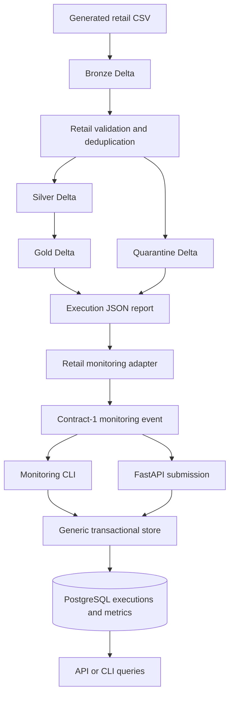

# PipelineIQ architecture through B3

- `pipelines/` owns retail data, validation, Delta tables and the retail adapter.
- `monitoring/events.py` owns generic event meanings and validation.
- `monitoring/store.py` owns PostgreSQL transactions, identity, lifecycle and queries.
- `monitoring/migrations/` owns versioned SQL schema changes.
- `api/` owns HTTP validation/translation, response models and status codes.
- JSON evidence and Delta data remain on disk; PostgreSQL stores measurements and references.

The diagram shows successful processing. Ordinary in-run failures also save reports
that can be adapted and submitted. A6's completion manifest publishes the successful
attempt's table paths; consumers must not combine every attempt directory.

There are three different protections against duplicate work. A6 reuses published
outputs for identical batch content. B1 exports one current snapshot per execution
identity. B2/B3 accept identical event redelivery without duplicating database rows.
A reused batch invocation still has its own run UUID, while exporting or submitting
that report does not create another execution.

PostgreSQL stores each event and its metric rows in one transaction. A running
snapshot may become terminal; contradictory terminal updates are rejected. The
API and CLI share this rule. No part of submission runs Spark or follows evidence
paths. Current queries are basic filtered inspection, not anomaly detection.

Local deployment uses a project PostgreSQL cluster with a private Unix socket and
an API bound to 127.0.0.1. Airflow (B4), history comparison (B5), ML, RAG and a web
dashboard remain future milestones. See the [event contract](monitoring-events.md),
[storage guide](monitoring-storage.md), [API guide](monitoring-api.md), and
[learning/progress log](PROGRESS.md) for the implemented behavior and measured tests.
