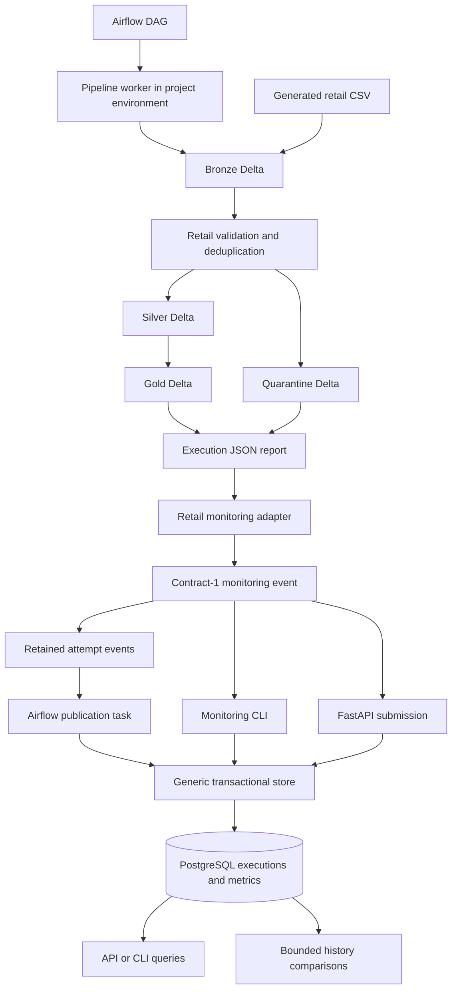

# PipelineIQ architecture through B5

- `pipelines/` owns retail data, validation, Delta tables and the retail adapter.
- `monitoring/events.py` owns generic event meanings and validation.
- `monitoring/store.py` owns PostgreSQL transactions, identity, lifecycle and queries.
- `monitoring/migrations/` owns versioned SQL schema changes.
- `api/` owns HTTP validation/translation, response models and status codes.
- `orchestration/` owns DAG dependencies, attempt evidence, delivery and final verification.
- `monitoring/history.py` owns bounded comparisons and totals with version/coverage rules.
- JSON evidence and Delta data remain on disk; PostgreSQL stores measurements and references.

The diagram shows successful processing. Ordinary in-run failures also save reports
that can be adapted and submitted. A6's completion manifest publishes the successful
attempt's table paths; consumers must not combine every attempt directory.

There are three different protections against duplicate work. A6 reuses published
outputs for identical batch content. B1 exports one current snapshot per execution
identity. B2/B3 accept identical event redelivery without duplicating database rows.
A reused batch invocation still has its own run UUID, while exporting or submitting
that report does not create another execution.

PostgreSQL stores each event and its metric rows in one transaction. A running
snapshot may become terminal; contradictory terminal updates are rejected. The
API, CLI and the DAG publication task share this rule. No part of submission runs
Spark or follows evidence paths. The DAG processing task alone launches the pipeline.
B5 compares a bounded window of runs, excluding failed/running/reused events from
successful-processing totals and grouping comparisons by versions. It does not
detect statistical anomalies.

Local deployment uses a project PostgreSQL cluster with a private Unix socket and
an API bound to 127.0.0.1. Airflow uses a separate constrained environment and local
SQLite metadata for manual DAG tests. Tasks share the project filesystem. The
publication task runs after failures; final verification depends directly on both
processing and publication success. ML, RAG and a web dashboard remain future work. See the [event contract](monitoring-events.md),
[storage guide](monitoring-storage.md), [API guide](monitoring-api.md), and
[orchestration guide](orchestration.md), [history guide](history.md), and
[learning/progress log](PROGRESS.md) for the implemented behavior and measured tests.
