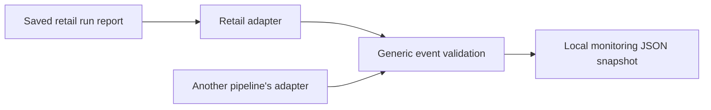

# Monitoring execution events — contract 1

B1 adds a shared JSON contract and a retail adapter. A contract is an agreement
about field names, types and meanings. An adapter translates a producer's existing
report into that agreement. `monitoring/events.py` depends only on Python's standard
library and has no imports from `pipelines/` or Spark. Retail-specific rules live
in `pipelines/monitoring.py`.



The second adapter in the diagram is an extension point, not a shipped integration.
An automated test submits a document-indexing event directly to the generic
validator to verify that it accepts different metric names and row relationships.

## Entry point

After running the sample pipeline, export its reports from the repository root:

```bash
for report in data/pipeline/metrics/*.json; do
  .venv/bin/python -m pipelines.monitoring --report "$report"
done
```

Each invocation prints the event and saves it at
`data/monitoring/events/<pipeline-id>/<run-id>.json`. Use `--output-dir` for another
root. `--report` must name a saved run report; a source CSV is not a run report.
There is no Java startup, Spark execution, Delta read or service connection.
An invalid report prints a field-specific error to stderr and exits with code 2.
Generated events are ignored by Git along with the rest of `data/`.

Call flow:

```text
pipelines.monitoring.main()
  → export_report(report_path, output_dir)
    → loads_json(): reject malformed JSON, duplicate keys and NaN/Infinity
    → adapt_report(): translate schema 1 retail reports and check retail semantics
      → validate_event(): enforce contract 1 and normalize timestamps to UTC
    → dumps_event(): deterministic JSON
    → atomic file replacement
```

Python callers can use `adapt_report(report)` without a report path. The CLI
includes the resolved report path in `evidence.report` so a reader can trace the
event back to its original measurements.

## Envelope

Every field below is required, even when its value is null or an empty object.
Unknown top-level fields and unsupported contract versions are rejected. Producer
reports have their own version: `contract_version` is **not** the retail report's
`schema_version` or validation policy version.

| Field | Type and meaning |
| --- | --- |
| `contract_version` | Literal string `"1"`; change when the event contract changes |
| `pipeline_id` | 1–128 ASCII letters/digits/underscores/dots/hyphens, starting with a letter or digit |
| `run_id` | Canonical lowercase, hyphenated UUID for this execution |
| `batch_id` | Producer's opaque batch label or null; an empty label can be evidence of a failed invocation |
| `status` | `running`, `completed`, `completed_with_warnings`, `failed`, or `reused` |
| `started_at` | ISO 8601 timestamp with `T` and explicit timezone; normalized to UTC |
| `finished_at` | Same timestamp format; null only while running; cannot precede start |
| `duration_ms` | Nonnegative integer elapsed milliseconds; null only while running |
| `reused_from_run_id` | Original execution UUID for `reused`; otherwise null; cannot reference itself |
| `row_counts` | Map of producer-defined row-count names to nonnegative integers or null |
| `quality_metrics` | Map of names to `{count, denominator, rate}` measurements |
| `properties` | Map of names to nonempty strings, such as producer/policy versions and exact decimal totals |
| `evidence` | Map of names to nonempty path/reference strings; references are not opened or executed |
| `error_summary` | Required nonempty text for failed executions; null for other statuses |

Map keys use lowercase snake_case, at most 64 characters, beginning with a letter.
Counts and duration must fit a signed 64-bit integer, matching B2 PostgreSQL
storage. Booleans, numeric strings and fractional counts are rejected rather than
coerced. The validator returns a detached copy; changing it does not mutate the
producer's report. Durations are independently measured elapsed time and are not
recomputed from wall-clock timestamp differences.

## Quality measurements and unknown values

Each quality measurement counts affected rows within its declared denominator:

```json
{"count": 11, "denominator": 80, "rate": 0.1375}
```

This example is measured missing-customer data from the saved incident run.
Different metrics may use different denominators. When both counts are known,
`0 <= count <= denominator`; a positive denominator gives `rate = count / denominator`.
A zero or unknown denominator, or an unknown count, requires a null rate. A
provided rate must agree with the ratio within `1e-12` relative/absolute tolerance;
validation serializes the calculated ratio. All rates must be finite and in [0, 1].

Examples of distinct meanings:

| Measurement | Meaning |
| --- | --- |
| `{count: 0, denominator: 80, rate: 0.0}` | Measured zero affected rows out of 80 |
| `{count: 0, denominator: 0, rate: null}` | Empty population; rate undefined |
| `{count: null, denominator: 80, rate: null}` | Input measured, quality step not measured |
| `{count: null, denominator: null, rate: null}` | Neither quantity measured |

Quality categories may overlap. Their sum is not the number of distinct bad rows.
The generic validator does not impose a row-conservation equation or require any
particular quality metric names. A document indexer can report four input documents
and eight output records; only its adapter can define the relevant relationship.

## Retail mapping

The adapter currently accepts `pipeline_id = retail_transactions` and source
`schema_version = "1"`. Required source fields cannot be missing. Additive source
fields are ignored unless explicitly mapped; changing source semantics requires
updating the adapter and its supported version.

| Saved report field | Monitoring event destination |
| --- | --- |
| Run/pipeline/batch IDs, times, duration, status, error | Same named envelope fields |
| `input_count`, `valid_count`, `quarantined_count` | `row_counts` |
| Quarantine, duplicate, missing-customer, invalid-amount counts | `quality_metrics` using their original names and `input_count` denominator |
| `schema_version`, `policy_version` | `properties.producer_schema_version`, `properties.policy_version` |
| `source_sha256`, `total_revenue` when known | Same names under `properties`; revenue stays exact decimal text |
| `source_path`, output table paths, report path | `evidence.source`, `evidence.bronze/silver/quarantine/gold`, `evidence.report` |
| `reused_from_run_id` when present | Same named envelope field |

For successful/reused retail reports every count, saved rate, source hash, revenue
and all four output paths must be present. The adapter checks conservation whenever
all row counts are known, ensures each quality category is within quarantine,
compares saved rates with measured counts, and checks the completed/warnings status
against the quarantine count. It does not rerun quality checks on source rows.
Failed/running reports preserve partial measurements and unknown nulls. Evidence
paths describe available report references, not an independent proof that the
pipeline published its completion manifest. Use A6's manifest to locate published
tables and its replay checks to verify stored artifacts.

## Identity, replay and file export

An event is a **current execution snapshot**, identified by `(pipeline_id, run_id)`.
Exporting one unchanged report again produces identical JSON at the same path and
leaves the existing file untouched. The exporter creates no new UUID or export-time
timestamp. A changed snapshot at that identity (for example, running → failed)
replaces the file atomically. Readers see an entire old or new JSON document.
Invalid updates and failed publication leave the previous exported file intact.

This local exporter is single-writer tooling, not an ordered event store: if you
explicitly export an older snapshot later, it can replace a newer one. It does not
keep an audit history or resolve concurrent/stale updates. B2 implements database identity and lifecycle rules separately from this file exporter;
see [monitoring-storage.md](monitoring-storage.md).

A *pipeline rerun* has a new run UUID. If A6 reuses a completed batch, its event
retains `status = reused` and `reused_from_run_id`. Count it as a separate execution
when studying invocation behavior, but exclude it when summing newly processed rows
or revenue. Reused counts describe the original outputs. Its short duration measures
verification, not a new processing job; exclude it from processing-time baselines.

B1 remains the file-export boundary. B2 adds PostgreSQL persistence and B3 adds
HTTP submission/query routes for the same contract; see the [storage guide](monitoring-storage.md)
and [API guide](monitoring-api.md). B4 now publishes events from Airflow task attempts,
adding orchestration_run_id and orchestration_attempt properties. B5 compares stored
events; see the [orchestration](orchestration.md) and [history](history.md) guides.

## Verification and exercise

```bash
.venv/bin/python -m pytest -q tests/unit/test_monitoring_events.py tests/unit/test_monitoring_adapter.py
bash scripts/test.sh
```

Tests cover unrelated pipeline metrics, UTC normalization, strict validation,
unknown/empty values, overlap, replay references, deterministic export, failed
publication and CLI errors. The CLI test disables site-packages to prove that
export works without importing Spark. Integration tests adapt real reports from
empty/all-invalid inputs, failed runs, partial writes and successful reuse.
See [PROGRESS.md](PROGRESS.md) for actual executions and measured results.

Exercise: export the incident report twice and compare the resulting file. Then
export its separate `reused` run report. Explain why the first action leaves one
event file while the second adds an execution without adding processed revenue.
