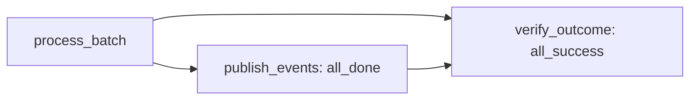

# Airflow orchestration (B4)

Airflow coordinates the existing pipeline and monitoring code. It does not own
retail validation or replace Delta/PostgreSQL. The DAG is manually triggered with
explicit source/batch parameters; it has no periodic schedule and no automatic
catchup. A logical date labels an Airflow run; it does not select an input CSV.

## Environment and entry points

Airflow 3.4.0 and standard provider 1.21.0 live in `.tools/airflow-venv`, separate
from the project `.venv`. The provider pin matches the official Python 3.12
constraints. The first install attempt used provider 1.22.0 and was rejected by
those constraints; the pinned requirements now resolve together. Setup uses the
uv bootstrap already documented in the README. Pipeline/API versions are retained.

```bash
bash scripts/setup-airflow.sh
bash scripts/postgres.sh start
export PIPELINEIQ_DATABASE_URL="host=$PWD/.cache/postgres-socket port=55432 dbname=pipelineiq"
.venv/bin/python -m monitoring.cli migrate
bash scripts/airflow.sh db migrate
bash scripts/airflow.sh python tests/airflow/check_dag.py
bash scripts/airflow.sh dags test pipelineiq_retail \
  --conf '{"source":"data/source/a2-healthy-001.csv","batch_id":"a2-healthy-001"}'
```

The source must already exist; generate fixtures using README commands first.
Repeat the DAG command to verify batch reuse, or supply the incident CSV/batch.
`dags test` executes a real DAG locally without requiring a persistent scheduler
or webserver. It does not simulate task work or mark tasks successful artificially.
The tested commands do not leave an Airflow service running. Check recorded DAG
state, rather than relying solely on the CLI's exit code for failed test runs.

`scripts/airflow.sh` configures the DAG folder and an isolated SQLite metadata
store under `data/airflow`. This is local development metadata, distinct from the
PostgreSQL monitoring database. Logs, metadata, constraints downloads and runtimes
are ignored by Git. Multi-host executors and a continuously running deployment
have not been validated. LocalExecutor is configured; `dags test` uses its default
local test execution path without `--use-executor`.

The implementation follows Airflow's official [constrained installation](https://airflow.apache.org/docs/apache-airflow/3.4.0/installation/installing-from-pypi.html),
[local DAG testing](https://airflow.apache.org/docs/apache-airflow/3.4.0/core-concepts/debug.html),
and [DAG-run state rules](https://airflow.apache.org/docs/apache-airflow/3.4.0/core-concepts/dag-run.html).

## Task graph and retries



- `process_batch` executes the full Bronze/Silver/quarantine/Gold runner in `.venv`,
  retaining one event per processing attempt. It retries once, after five seconds.
- `publish_events` runs after processing reaches a terminal state, including failure.
  It submits every retained attempt event to B2's PostgreSQL store. It retries twice.
- `verify_outcome` requires both preceding tasks to succeed. It checks the latest
  receipt and publication acknowledgements. A successful failure-reporting task
  cannot turn failed processing into a successful DAG.

Every task has a 20-minute execution timeout. Maximum active DAG runs is one.
Task arguments are passed through environment values and quoted shell variables,
never interpolated into executable shell text. The DAG file imports Airflow only;
it does not import Spark or open database connections while being parsed.

A DAG is a dependency graph: arrows tell the scheduler which prerequisites must
finish. A retry is another attempt at one task, not a new logical source batch.
Airflow retry numbers and pipeline execution UUIDs are different identifiers.

## Processing and delivery evidence

`scripts/orchestrate.sh` selects the existing Python/Java runtime and starts
`orchestration.worker`. Its three commands are `process`, `publish`, and `verify`.
The DAG supplies source, batch, orchestration-run key and attempt number.

Each attempt has a directory:

```text
data/orchestration/<sha256-of-dag-and-run-id>/attempt-000001/
  worker.lock
  event.json
  receipt.json
  published.json   # created only after database acknowledgement
```

The worker reserves a fresh execution UUID and passes it to `run_pipeline` so it
can locate the exact report on success or failure. Initial report publication is
atomic and refuses an already used UUID. The runner still saves all normal metrics
under `data/pipeline/metrics`; A6 still controls batch publication and reuse.

The adapter turns a saved report into a monitoring event and adds orchestration
run/attempt properties. If Spark startup fails before any pipeline report exists,
the worker creates a failed generic event with unknown row counts and
`failure_stage=worker_startup`. That fallback duration includes startup work;
normal pipeline reports retain their existing timing scope. A Spark-stop warning
is logged separately and does not invalidate already committed pipeline results.

An event is saved before the receipt. Repeating an already receipted attempt
returns its recorded outcome; changing its source path, batch or pipeline root is
rejected. A genuine task retry has a new attempt number and pipeline UUID. Failed
attempts remain inspectable even when a later attempt succeeds.

Publication retries resubmit identical events. B2 returns unchanged for duplicate
delivery, including when an acknowledgement was lost after a database commit.
Delivery does not rerun Spark. If all publication retries fail, local events remain
available for a later `publish` retry; the DAG cannot report success.

Defaults are `data/pipeline` for the pipeline root and `data/orchestration` for
attempt evidence. `PIPELINEIQ_PIPELINE_ROOT` and `PIPELINEIQ_ORCHESTRATION_ROOT`
select separate environments. All tasks must share the same filesystem and
PostgreSQL configuration. No automatic evidence cleanup is implemented.

A hard process/host kill may prevent event/receipt creation; running reports or
unpublished attempts can remain. The final DAG state still fails when processing
fails, but complete crash-reconciliation and exactly-once event delivery are not
claimed. A6's completion manifest remains authoritative for published data.

## Executed verification and exercises

Run the separate Airflow checks after installing both environments and migrating:

```bash
export PIPELINEIQ_TEST_DATABASE_URL="host=$PWD/.cache/postgres-socket port=55432 dbname=pipelineiq_test"
bash scripts/airflow.sh python tests/airflow/check_dag.py
.venv/bin/python tests/airflow/check_workflow.py
```

The workflow check uses the dedicated `_test` database and a fresh data directory.
It executes four real DAG scenarios and asserts Airflow metadata state, saved
PostgreSQL events and the number of data attempts:

| Scenario | Final DAG state | Stored attempt statuses |
| --- | --- | --- |
| Healthy input | success | completed |
| Repeat batch | success | reused |
| Permanently missing source | failed | failed, failed |
| Source arrives after first failure | success | failed, completed |

All four passed on 2026-11-24. Logs and test artifacts remain under
`data/airflow-checks/<uuid>`; the script prints the location. Structural checks
verify retry counts, dependencies and parameter handling. Worker tests cover
startup failures, receipt reuse, configuration conflicts and missing acknowledgements.

Exercise: explain why publication uses `all_done`, while final verification depends
on successful processing **and** successful publication. Then distinguish a
processing retry from retrying delivery of an already saved event.
